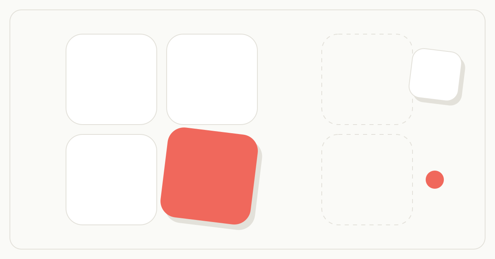

# Photo Grouper

> A privacy-first, offline-capable photo collage maker. Your photos never leave your device.



Photo Grouper is a [Next.js](https://nextjs.org) PWA for turning 2–9 photos into a clean, shareable collage — entirely in your browser. There is no account, no upload, and no server-side processing. Every pixel is loaded, edited, and exported locally.

## ▶️ Try it free

**[photogrouper.com](https://photogrouper.com)** runs this exact app right in your browser — free, no account, no install, nothing to download.

> **Verifiable privacy:** everything runs client-side, so your photos never leave your device *even on the hosted site*. You don't have to take our word for it — this repository **is** the code that runs there, and you can read every line. See the [Privacy Policy](PRIVACY.md) for exactly what is and isn't collected.

## Why Photo Grouper?

- **🔒 Privacy-first** — photos are read and processed in-browser and never uploaded anywhere.
- **🔍 Open & auditable** — MIT-licensed and fully open source, so the privacy claim above is verifiable, not just marketing copy.
- **📴 Offline-capable** — installable PWA with a service worker; works without a connection.
- **⚡ No account, no friction** — open it and start; nothing to sign up for.
- **🪶 Lightweight** — no image backend, no storage, no AI inference. Just a static client-side app.

## Local gallery integration

The local development version adds a browser-only photo library before the collage editor.
Open image files or a folder (including its subfolders), browse a virtual grid, and choose
2–9 originals for a collage. Workflow-specific routes retain their existing two-photo limit.

- Grid controls: square, 4:3 landscape, 3:4 portrait, or original proportions fitted within square cells;
  thumbnail size, 0–12 px gaps (2 px default), fill/fit, and optional filenames.
- Filename/path search, folder and orientation filters, filename/date sorting.
- Fullscreen viewer with zoom, keyboard navigation, a thumbnail strip and collage selection.
- Click a thumbnail to select/deselect it; the corner expand button opens the large preview.
- Numbered selection tray; Shift-click selects a range up to the workflow limit.
- Drag image grips to reorder the library or selected tray; focus a grip and use arrow keys
  for the same action. Library changes select Manual order. Filtered moves preserve hidden entries.
- Local colour suggestions preview a sequence using edge or centre pixels, with Apply/Discard.
  These are background/outfit hints, not semantic recognition. No image is removed or uploaded.
- 73 layouts, including 24 additional editorial presets. Resize cells exposes shared dividers
  with drag/arrow-key adjustment and a 10% minimum cell size; Reset cell sizes restores the preset.
  Floating layouts with no safe shared edges keep their fixed geometry. Existing crop and gap controls remain available.
- View preferences are remembered locally. General library files and collage edits are session-only;
  named post bundles explicitly saved by the user persist their selected photos and settings locally. Browser-supported formats only; unsupported images show a placeholder.
- Two concurrent image decodes and an LRU cache of 128 small thumbnail blobs. Orientation indexing
  runs progressively; results may be incomplete until indexing finishes.
- Only selected originals enter the editor, without the previous 1920 px import reduction.
  Export still uses the existing 1080/2000/4000 longest-edge options.
- No original files are changed or uploaded. Folder selection requires user action and browser support.

## Features

- **Layouts** — many templates for 2 through 9 photos, in `clean`, `polaroid`, `rounded`, and `artistic` styles.
- **Per-photo editing** — pan, zoom, and rotate each slot; adjust brightness, contrast, saturation, and blur.
- **Touch gestures** — drag to pan, pinch to zoom, long-press to arm a photo swap.
- **Instagram-style filters** — Mono, Noir, Sepia, Vintage, Fade, Warm, Cool, Vivid, and more, with live previews and "apply to all".
- **Output aspect ratios** — export for Instagram (1:1, 4:5), Stories/Reels (9:16), YouTube/X (16:9), Pinterest (2:3), and more.
- **Style controls** — background color, photo gap, corner radius, and outer padding.
- **Canvas export** — high-resolution JPEG output that matches the editor preview, via the native share sheet or download.

## Tech Stack

| Layer | Technology |
|-------|------------|
| Framework | Next.js 16 (App Router) |
| UI | React 19 |
| Language | TypeScript |
| Styling | Tailwind CSS v4 |
| Icons | Lucide React |
| Image compression | browser-image-compression |
| PWA | @ducanh2912/next-pwa |

## Getting Started (self-hosting & development)

> Just want to make a collage? Use the free hosted app at **[photogrouper.com](https://photogrouper.com)** — no setup required. The steps below are only for running or modifying the project yourself.

Requires **Node.js 20+**.

```bash
# Clone
git clone https://github.com/namabeeru/photo-grouper.git
cd photo-grouper

# Install dependencies
npm install

# Start the dev server
npm run dev
```

Open [http://localhost:3000](http://localhost:3000) in your browser.

### Other commands

```bash
npm run build   # Production build (includes the offline service worker)
npm run start   # Serve the production build
npm run lint    # Run ESLint
```

### Environment variables

All variables are optional — the app runs with none set.

| Variable | Default | Purpose |
|----------|---------|---------|
| `NEXT_PUBLIC_ENABLE_ANALYTICS` | `false` | Set to `true` to enable [Vercel Web Analytics](https://vercel.com/docs/analytics). Off by default so self-hosted and forked deployments don't emit analytics. |
| `NEXT_PUBLIC_SITE_URL` | inferred | Canonical site URL used for social / Open Graph metadata. |

## How It Works

Photo Grouper is a three-phase client-side state machine — **Home → Selection → Editor** — with all state held in React (`app/page.tsx`). Selected images are compressed with `browser-image-compression`, arranged into a chosen template, edited per slot, and finally rendered to a `<canvas>` for export. Nothing is ever sent to a server.

For a deeper dive into the architecture, components, and rendering pipeline, see [ARCHITECTURE.md](ARCHITECTURE.md).

## Deployment

The official hosted instance is **[photogrouper.com](https://photogrouper.com)**.

This is a standard Next.js app and also deploys cleanly to any platform that supports Next.js (Vercel, Netlify, Cloudflare, a Node host, etc.). Because all processing is client-side, no environment variables or backend services are required to run it. To turn on Vercel Web Analytics for your own deployment, set `NEXT_PUBLIC_ENABLE_ANALYTICS=true` (see [Environment variables](#environment-variables)).

## Contributing

Contributions are welcome! New collage templates, filters, bug fixes, and accessibility improvements are all great places to start. See [CONTRIBUTING.md](CONTRIBUTING.md) for setup and guidelines.

## Trademark & Brand

The source code is MIT-licensed, but the **Photo Grouper name and logo are not** — please rebrand your forks. See [TRADEMARK.md](TRADEMARK.md) for details.

## License

[MIT](LICENSE) © namabeeru

## Named post bundles

Choose **Post bundle** in the gallery to shortlist photos and videos independently of collage
selection. The shortlist is organised into pages — up to 20 pages of up to 9 items each, with the
first item of page 1 as the cover (`#01 · COVER`). The shortlist holds at most 500 MiB of sources;
each image may be up to 25 MiB and each video (.mp4, .mov, .webm, .m4v) up to 500 MiB, with a
thumbnail generated automatically. Prepare the bundle, give it a nickname, reorder items, tune
each page's ratio / export width / background, and save a local draft. Saved bundles retain
original files and order in IndexedDB on this browser origin; clearing browser data or changing
the local host/port makes that local library unavailable. Export a ZIP backup for portability.

Originals export byte-for-byte by default, including embedded metadata. Per-page ratio presets
(Original, square 1:1, portrait 4:5, portrait 3:4 and landscape 1.91:1) and per-image crop/fit,
zoom and position controls produce optional JPEG posting copies. Those edits never alter source
files. A posting-copy ZIP also includes the originals and crop recipe so restoration remains
lossless. The contact sheet is separate from the numbered posting images. ZIP backup restoration
is for app-produced bundle archives, not arbitrary ZIP libraries; older single-page (v1) archives
restore into the multi-page model automatically.

If saving fails (for example storage quota), the current draft remains in memory as unsaved and
ZIP export remains available. Downloading a ZIP and saving a browser draft are separate actions.
On iPhone, extract the ZIP in Files and import the images folder; check the numbered sequence
against the contact sheet before posting. The app does not upload, publish or guarantee the order
chosen by Photos or Instagram.
